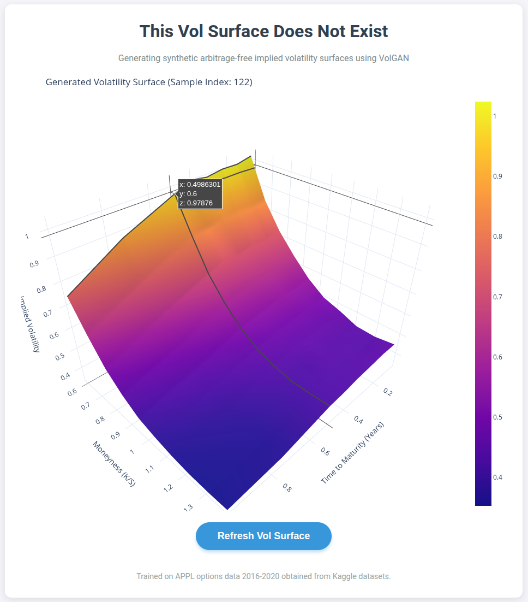

# VolGAN (Fork)

This repository contains a fork of VolGAN, a generative adversarial network for producing implied volatility surfaces while penalizing static arbitrage violations.

The original project summary can be seen in README.orig.md.

This fork extends the original code toward a more practical local workflow:

- Added a CLI workflow in volgan_cli.py for:
  - Surface generation from raw options CSVs
  - Input analysis
  - Training
  - Simulation and 3D HTML output
- Shifted data handling toward local CSV pipelines (no required Yahoo fetch path in the main forked flow).
- Added structured return types in training API (VolGANResults) for clearer downstream use.
- Improved tensor/device handling in key numerical paths to reduce CPU/GPU mismatch issues.
- Updated smoothness penalty construction and related training internals for more explicit matrix/weight handling.
- Added packaging metadata via pyproject.toml and dependency pinning for reproducible setup.

## Instructions

1) Setup

Use Python 3.13+ and pip or install dependencies from pyproject.toml.

```bash
python -m venv .venv
source .venv/bin/activate
pip install --upgrade pip
pip install -e .
```

You will also need to install the python version of [Peter Jäckel's Let's Be Rational](http://www.jaeckel.org/LetsBeRational.7z).

2) Prepare Input Data

You need:
- Price history CSV (example: AAPL-prices.csv)
- Raw options/volatility CSV (example path in this repo: Kaggle/aapl_2016_2020.csv)

You can also provide a pre-generated surface CSV directly.

3) Generate Surfaces (if needed)

```bash
python volgan_cli.py \
  --generate-surface \
  --price-data-path data-in/AAPL-prices.csv \
  --raw-vol-data-path data-in/aapl_2016_2020.csv \
  --surface-path surfacepath/surfaces_transform_enhanced.csv
```

4) Analyze Inputs

```bash
python volgan_cli.py \
  --analyze \
  --price-data-path data-in/AAPL-prices.csv \
  --surface-path data-out/surfaces_transform_enhanced.csv
```

5) Train

```bash
python volgan_cli.py \
  --train \
  --price-data-path data-in/AAPL-prices.csv \
  --surface-path data-out/surfaces_transform_enhanced.csv \
  --device cpu
```

Notes:
- Set --device cuda if your CUDA setup is available.
- Training artifacts are saved to volgan_res.pkl and a timestamped backup.

6) Simulate and Export Surface Plot

```bash
python volgan_cli.py --simulate --device cpu
```

This writes an interactive surface file generated_surface.html.

### Toy - This Vol Surface Does Not Exist Demo

Starts a web server that generates 3d interactive vol surfaces (from latent space).

```bash
python volgan_tvsdne.py \
  --port 8080
```

Note that the training input data is probably not very high quality (from Kaggle).

